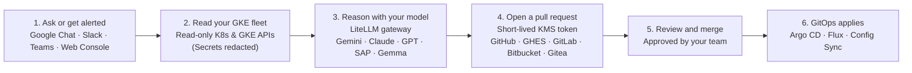

import { Aside, Card, CardGrid, LinkCard } from "@astrojs/starlight/components";
import ChatDemo from "../../components/ChatDemo.astro";

<ChatDemo />

## What platform teams are measured on

Platform owners are measured on three goals, in priority order. `kube-agents` runs continuously inside your GKE environment to give your team more reach on each one while keeping your engineers in control.

<CardGrid>
  <Card title="Keep production healthy" icon="approve-check-circle">
    Checks every cluster against 25+ upgrade-readiness rules and watches drift,
    stalled controllers, crash loops, security posture, and capacity around the
    clock — flagging blockers before they page anyone.
  </Card>
  <Card title="Developer velocity" icon="rocket">
    Developers ask in Google Chat, Slack, or the Web Console why a pod is
    failing or how to right-size a service, and get a grounded answer or a pull
    request to approve instead of waiting in a ticket queue.
  </Card>
  <Card title="Team efficiency" icon="setting">
    Takes on routine upgrade checks, security patches, and repeat triage across
    your fleet so platform engineers spend their time on hard architecture and
    incident work.
  </Card>
  <Card title="Your team stays in control" icon="shield">
    Read-only in your clusters, isolated credentials in a broker, and every
    production change delivered as a pull request your team reviews and merges.
  </Card>
</CardGrid>

## Three reasons you can trust it

Many platform teams have tried building their own SRE agent; connecting a bot to chat was never the hard part. `kube-agents` is built around three design commitments.

<CardGrid>
  <LinkCard
    title="Built and tested in the open"
    description="Apache 2.0 open source, built and maintained by Google engineers. Ships 70+ GKE skills gated by hands-on exams across 13 operational domains on every release."
    href="/kube-agents/overview/trust-and-autonomy/"
  />
  <LinkCard
    title="Never acts alone"
    description="Wire-level read-only Kubernetes access (Secrets redacted), credentialless shell sandbox, short-lived Cloud KMS forge tokens, and GitOps pull requests for every fix."
    href="/kube-agents/reference/security-and-iam/#what-the-agent-can-and-cannot-do"
  />
  <LinkCard
    title="Models, cost, and BYOT"
    description="$0 software license, co-exists on any GKE Standard or Autopilot cluster, and brings your own tokens across Gemini, Claude, GPT, SAP AI Core, or self-hosted Gemma."
    href="/kube-agents/overview/models-and-cost/"
  />
  <LinkCard
    title="See it in action"
    description="Watch six live Web Console walkthroughs covering reliability, capacity, security, GKE upgrades, cost right-sizing, and Argo CD fleet drift."
    href="/kube-agents/deploy/web-console/"
  />
</CardGrid>

## How it works in six steps



`kube-agents` never mutates a cluster directly. Every diagnostic runs under a read-only identity, and every proposed fix lands as a pull request for your existing GitOps pipeline to apply. See [Architecture](/kube-agents/overview/architecture/) for the full pod topology and component map.

## Explore the documentation

<CardGrid>
  <LinkCard
    title="Why kube-agents"
    description="Platform goals, why home-built SRE agents stall, and how always-on fleet care complements IDE coding agents."
    href="/kube-agents/overview/what-is-kube-agents/"
  />
  <LinkCard
    title="A day with kube-agents"
    description="From hour-one fleet scan to day-one audits, team memory, and pull requests across real operational scenarios."
    href="/kube-agents/overview/day-in-the-life/"
  />
  <LinkCard
    title="Proactive autonomy"
    description="Ten scheduled watchdogs covering security, upgrades, cost, capacity, stalls, and drift — with reproducible commands on every finding."
    href="/kube-agents/overview/proactive-autonomy/"
  />
  <LinkCard
    title="Skill catalog"
    description="70+ GKE skills across reliability, security, upgrades, capacity, cost, and fleet audits, linked directly to source."
    href="/kube-agents/skills/"
  />
</CardGrid>

<Aside type="note">
  Today's shipping skills, install path, and MCP integrations target GKE. The
  operator, inference gateway, and ChatOps architecture can extend to other
  Kubernetes distributions as skills and toolsets are added.
</Aside>

## Install

`kube-agents` is Apache 2.0 open source with no license fee or token markup. It installs into its own isolated `kubeagents-system` namespace on an existing GKE Standard or Autopilot cluster, or can bootstrap a new cluster for you.

Install from an unpacked official release archive (recommended):

```bash
curl -fsSL https://github.com/gke-labs/kube-agents/releases/download/<RELEASE_VERSION>/kube-agents-<RELEASE_VERSION>.tar.gz | tar -xz
cd kube-agents-<RELEASE_VERSION>
./install.sh
```

_Substitute `<RELEASE_VERSION>` with the latest tag from [GitHub Releases](https://github.com/gke-labs/kube-agents/releases) (for example, `0.39.0`)._

Or run the one-liner directly in Google Cloud Shell or your terminal:

```bash
curl -fsSL https://raw.githubusercontent.com/gke-labs/kube-agents/<RELEASE_VERSION>/install.sh | bash
```

See the [Quick start (GKE)](/kube-agents/install/quickstart-gke/) for prerequisites, existing-cluster vs. new-cluster options, and non-interactive flags.

## Disclaimer

`kube-agents` is developed in the open on GitHub under the Apache 2.0 license by Google engineers and community contributors. This is not an officially supported Google product.
