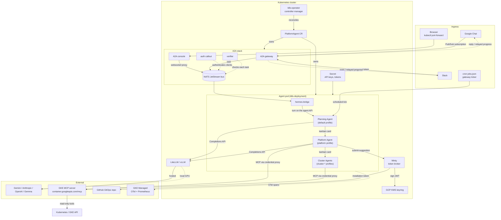

import { Aside } from "@astrojs/starlight/components";

Ingress paths converge on the agent pod: user chat, scheduled cron, and the operator itself. Chat enters through the **A2A gateway** and a message bus ([the quick start](/kube-agents/install/quickstart-gke/#verify-the-a2a-stack)), and a `hermes-bridge` container in the agent pod turns each bus task into an agent turn.

Inside the pod, one Hermes gateway hosts three co-located profile roles: the **Planning Agent** (`default` profile, the conversational front door), the **Platform Agent** (`platform` profile, fleet audits and GitOps PRs), and per-cluster read-only **[Cluster Agents](/kube-agents/concepts/cluster-agents/)** (`cluster-*` profiles). They coordinate through a shared kanban board: the Planning Agent files a card, the dispatcher runs the specialist worker, and the result posts back to the originating chat thread.

## Component map

The gateway holds Google Chat and Slack, either or both. [Deployment topology](#deployment-topology) lists the pods.

## The request flows

### 1. Chat request → reply

<Aside type="note">
  Google Chat is fully wired and end-to-end tested. Slack is opt-in via the
  installer's chat menu; see [ChatOps](/kube-agents/concepts/chatops/).
</Aside>

1. A user posts in a Google Chat space (or DMs the Slack app).
2. Google Chat publishes the event to a Pub/Sub topic; Slack routes via Socket Mode. The install's [`chat-pubsub` module](https://github.com/gke-labs/kube-agents/tree/main/terraform/modules/chat-pubsub) sets up the topic and subscription.
3. The **A2A gateway** consumes the event, posts a status line in the thread (on Google Chat; on Slack the Working… status and the reaction stand in for it), and publishes the message as a task on the bus. The `hermes-bridge` container in the agent pod takes the task and runs it as a turn on the agent's API server, under the **Planning Agent** (the pod's `default` Hermes profile). [How a chat question is answered](/kube-agents/concepts/chatops/#how-a-chat-question-is-answered) walks through each hop.
4. The Planning Agent holds no infrastructure tools. It reads the available specialists from the roster block injected into each turn (descriptions from each agent's `CAPABILITIES.md`; `list_agents` re-reads it) and files a kanban card with the full request context (`kanban_create`). The originating chat session is auto-subscribed to the card. The two questions the roster answers itself, which GCP projects are in scope and where the host cluster is, get a direct reply and no card.
5. The gateway's kanban dispatcher spawns the **Platform Agent** (`hermes -p platform chat -q "work kanban task <id>"`), which runs the tool-calling loop: system prompt (`SOUL.md`) + card body + available tools. Cluster reads go through the `gke` MCP server; mutations that touch infra route through the `submit-suggestion` skill (see flow 3) rather than direct `kubectl`. Work scoped to one cluster's live runtime is delegated onward as a nested kanban card to that cluster's read-only [Cluster Agent](/kube-agents/concepts/cluster-agents/) (`SOUL.md §6`).
6. The worker's `kanban_complete` posts its full `result` back into the same Chat thread (its one-line `summary` only when the `result` adds nothing to it), plus one message for each staged sub-card completion along the way. They are delivered directly rather than through the Planning Agent, so the answer arrives verbatim; the A2A gateway posts them, each progress note as a message of its own. Console links are built from the shared templates in `agents/platform/docs/gcp-console-links.md` (inlined in `SOUL.md §5`).

### 2. Cron tick → autonomous run

1. The Planning Agent profile's gateway — the only ticking one, since cron ticking belongs to a running gateway — evaluates its own `jobs.json` on schedule. Its `profile-cron-tick` job runs `hermes cron tick` against every named profile with work due, once a minute, which is what makes the Platform Agent's own roster live (see [What fires the schedule](/kube-agents/concepts/autonomous-watchdogs/#what-fires-the-schedule)).
2. The governance watchdogs live on that roster, `agents/platform/cron/jobs.json`. A due one runs in its own process with the Platform Agent's persona and toolsets and its own `skills` and `max_turns` — no kanban card involved. The prompt is usually "read `governance/<sop>.md` in your profile home and execute"; the path is relative to the profile home, where `profile_scaffold.py` overlays the baked `/opt/platform-template/governance/` directory.
3. The agent reads the SOP, executes the diagnostic queries, produces findings.
4. The ten fleet audits hand their findings to the `fleet-audit` skill, which maintains one GitHub ledger issue per audit stream and opens narrow remediation PRs for mergeable fixes. A clean scheduled run closes the ledger and returns `[SILENT]`. It posts when findings resolve, when an on-demand run changes findings, or when fleet read gaps are new.

The Planning Agent's job file ([`agents/chat/defaults/cron/jobs.json`](https://github.com/gke-labs/kube-agents/blob/main/agents/chat/defaults/cron/jobs.json)) runs script-only `no_agent` jobs with no LLM turn. Active jobs are `profile-cron-tick` (advances named-profile schedules), `cluster-agent-reconcile` (hourly Cluster Agent sync), and `oobe` ([first-run onboarding](/kube-agents/concepts/chatops/#first-run-onboarding)).

### 3. Remediation → GitHub PR

1. The agent invokes `submit-suggestion` with a proposed diff (usually a YAML patch generated from an SOP).
2. `submit-suggestion` writes the file(s) and commits them to a topic branch, then asks the credential broker to publish it. Nothing in the agent's container holds a token.
3. The broker calls Minty, which signs a JWT with a KMS-held private key and exchanges it for a short-lived GitHub App token.
4. The broker pushes the branch and opens a PR against the configured GitOps repo; `submit-suggestion` gets back the PR's URL.
5. The agent posts a Chat message with the PR link.

## Deployment topology

Everything except the LLM (and, for hosted providers, the LLM API endpoint) runs inside your Kubernetes cluster:

- **Namespace**: `kubeagents-system`.
- **The agent**: three pods, the gateway (`<name>-gateway`, running Hermes), the shell sandbox and the credential broker ([Credential isolation](/kube-agents/reference/credential-isolation/#pod-anatomy)).
- **The A2A stack**: the bus StatefulSet (`<name>-a2a-nats`), two auth callout and two verifier replicas, the A2A gateway, the A2A console, the MCP server, the profile dispatcher, a provisioning Job, and a session pod per `/session` conversation. `hermes-bridge` is a container of the gateway pod rather than a pod. [Verify the A2A stack](/kube-agents/install/quickstart-gke/#verify-the-a2a-stack) lists each pod with its expected state.
- **Node pools**: Autopilot, the shape a fresh install creates, has none to size — Google schedules the operator, Platform Agent, LiteLLM, and Minty, and the sandbox costs no extra nodes. On Standard the default node pool runs everything except the Platform Agent, which runs on the gVisor pool below; `--enable-gvisor=false` puts it back with the others. If you use vLLM, provision a GPU node pool separately.
- **gVisor node pool** for sandboxed skill execution, Standard only (the `gke-cluster` module's `enable_gvisor_node_pool`). The sandbox is on unless the installer's `--enable-gvisor=false` turns it off, so a Standard install gets this pool; Autopilot ships the `gvisor` RuntimeClass and needs no pool.
- **Workload Identity** bindings are pre-provisioned by the [`kube-agents-iam` module](https://github.com/gke-labs/kube-agents/tree/main/terraform/modules/kube-agents-iam) — the Platform Agent gets a configurable permission set (`read-only` or `custom`). See [Security & IAM](/kube-agents/reference/security-and-iam/).

### Capacity and isolation

The operator, LiteLLM and Minty stay small across fleet sizes. The Platform Agent starts at `small` and promotes runtime pods under `sizingProfile: auto` at 10 (`medium`) and 25 (`fleet`) managed clusters (see [Fleet sizing](/kube-agents/deploy/fleet-sizing/)). What drives node capacity:

- **vLLM.** Local inference needs a GPU node pool; hosted LiteLLM does not.
- **gVisor and fleet sizing.** Sandboxed skill execution puts the agent pod under the `gvisor` RuntimeClass, which is the default (`--enable-gvisor=false` turns it off). On Autopilot, the default cluster shape, it costs no extra capacity. On Standard it adds a `gvisor-pool` (`e2-standard-4` per zone by default, autoscaling to two) and a default pool. Fresh installs using `auto` or `fleet` at 25 or more clusters set or offer `TF_VAR_sizing_profile=fleet` (`n2-standard-8`, 8 vCPU) so the 4 vCPU fleet broker schedules. The module's [sizing inputs](https://github.com/gke-labs/kube-agents/blob/main/terraform/modules/gke-cluster/README.md#sizing-the-node-pools) change machine types, disks and bounds.

For production, prefer a **dedicated cluster** for the harness. The agent GSA can still be given broad GKE permissions through the `custom` permission set, so a hard cluster boundary limits blast radius if the execution sandbox is ever compromised. A shared cluster (with the `kubeagents-system` namespace for logical isolation) is fine for development.

## Failure modes worth knowing

- **LLM outage.** LiteLLM proxies retries and can fall back to a secondary provider if configured. `SOUL.md §4` retries via the recovery ladder and reports failures in Chat rather than hanging.
- **Silent kanban workers.** Delegated cards post progress notes via `kanban_heartbeat` and report results on `kanban_complete` or `kanban_block`. A worker that stalls or hits a turn limit is retried once and then blocked; run `hermes kanban show <id>` to inspect attempt errors. See [`spec.harness.tuning`](https://github.com/gke-labs/kube-agents/blob/main/docs/designs/internals/platformagent-harness.md#specharnesstuning) and [ChatOps](/kube-agents/concepts/chatops/).
- **Cron overlap.** Each scheduled job holds a per-job lock so it never overlaps itself, while different jobs can run concurrently without blocking the 10-minute `github-repo-watcher` script. See [Autonomous watchdogs](/kube-agents/concepts/autonomous-watchdogs/#what-fires-the-schedule).
- **Forge token refresh failures.** GitHub App installation tokens are 1-hour scoped and re-minted by Minty on demand. If the credential broker cannot reach or authenticate with the forge, it surfaces a detail-free reason code in chat and logs redacted diagnostics in `envoy-credential-proxy` and Minty. See [Credential isolation](/kube-agents/reference/credential-isolation/).
- **Pub/Sub subscription drift.** If the Google Chat Pub/Sub subscription is deleted out of band, chat messages stop arriving while cron watchdogs continue running. Use the `kube-agents-observability` skill to diagnose.

## Where to go next

- [Platform Agent](/kube-agents/concepts/platform-agent/) — the persona, safety rails, and MCP wiring.
- [ChatOps](/kube-agents/concepts/chatops/) — Google Chat and Slack ingress details.
- [Declarative workflow](/kube-agents/concepts/declarative-workflow/) — how PR-based remediation is enforced.
- [`docs/designs/agent-communication.md`](https://github.com/gke-labs/kube-agents/blob/main/docs/designs/agent-communication.md) — the design of record for inter-agent coordination: a file-based handover channel as its primary topic, still a proposal, and the kanban delegation the profiles use today.
- [`docs/designs/spec-mode-switch.md`](https://github.com/gke-labs/kube-agents/blob/main/docs/designs/spec-mode-switch.md) — the design that introduced the A2A stack behind the now-deprecated `spec.mode` switch; [Deployment topology](#deployment-topology) above is the inventory of what runs.
