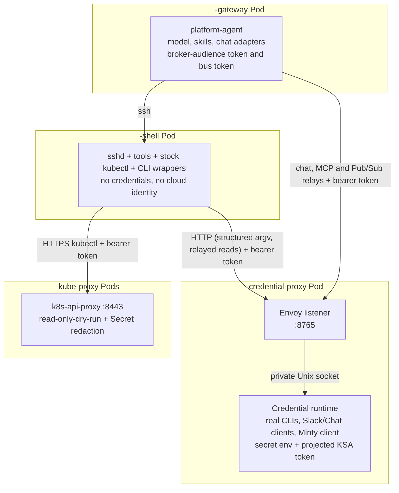

Part of [Credential isolation](/kube-agents/reference/credential-isolation/).

## Pod anatomy

Each PlatformAgent runs as four Pods (`<name>-kube-proxy` runs two replicas). The operator adds the A2A stack's Pods beside them and one container to the gateway Pod; [the A2A stack's Pods](#the-a2a-stacks-pods) below lists them.

| Pod / container                        | Trust level | Role                                                                                                                                                                                                                                                                                                                            |
| -------------------------------------- | ----------- | ------------------------------------------------------------------------------------------------------------------------------------------------------------------------------------------------------------------------------------------------------------------------------------------------------------------------------- |
| **`<name>-gateway`**                   |             |                                                                                                                                                                                                                                                                                                                                 |
| &nbsp;&nbsp;`platform-agent`           | Untrusted   | The model, the skills and the chat adapters. No CLI, and two credentials: the broker-audience token and the bus token.                                                                                                                                                                                                          |
| &nbsp;&nbsp;`agent-api-auth`           | Trusted     | The PlatformAgent API front door; the event watcher, which forwards cluster events on its own Kubernetes-API token; and, where enabled, the drift detector, which pulls audit records. Both make their Google calls (fleet clusters, Pub/Sub) through the broker's watcher routes. And the audit-report store listener on 8700. |
| &nbsp;&nbsp;`fluent-bit`               | Trusted     | Log forwarding.                                                                                                                                                                                                                                                                                                                 |
| &nbsp;&nbsp;`platform-agent-dashboard` | Untrusted   | Optional local dashboard (also credential-free).                                                                                                                                                                                                                                                                                |
| &nbsp;&nbsp;`hermes-bridge`            | Untrusted   | Takes tasks off the bus and runs each as a turn on the agent's API server. Built from the agent image with the agent's mounts; holds the `bridge` bus password, never the Pod's bus token.                                                                                                                                      |
| **`<name>-shell`**                     | Untrusted   | `sshd`, `/opt/data`, the agent's tools, stock `kubectl` wired to `<name>-kube-proxy`, and the broker CLI wrappers. Everything the model executes runs here.                                                                                                                                                                     |
| **`<name>-kube-proxy`**                | Trusted     | The Kubernetes API proxy (two replicas). Verifies sandbox and session tokens, enforces `read-only-dry-run` policy, and redacts `Secret` values.                                                                                                                                                                                 |
| **`<name>-credential-proxy`**          | Trusted     | Envoy, the credentialed command and chat runtime, the Minty client. Runs nothing the model wrote.                                                                                                                                                                                                                               |

`agent-api-auth` is a **native sidecar** — an `initContainers` entry with `restartPolicy: Always`, needing Kubernetes 1.29+ — so it starts before the others and does not appear in `spec.containers`.

### The A2A stack's Pods

The operator also renders the A2A stack ([Architecture → Deployment topology](/kube-agents/overview/architecture/#deployment-topology)). The session pods are the only ones that run an agent; the rest hold the one bus identity each needs and no forge or cloud credential:

- **`<name>-a2a-nats-0`**: the NATS JetStream bus, with the TLS websocket listener the console server proxies to. It holds the certificate its listeners serve and nothing of the agent's.
- **`<name>-a2a-callout`** (two replicas): the auth callout that authenticates every bus client, resolving a projected ServiceAccount token to its principal's grants with a Kubernetes `TokenReview`. It holds the issuer keys in `<name>-a2a-callout-keys`.
- **`<name>-a2a-verifier`** (two replicas): the capability verifier, the only principal that may read the `cap` bucket; a task submitted while no verifier is ready is refused.
- **`<name>-a2a-gateway`**: the chat backend and the console door. It holds the Slack tokens when it holds Slack, and reaches Google Chat through the broker with the `kubeagents-credential-proxy-a2a-chat` audience described below. On every install it also holds a `kubeagents-credential-proxy-a2a-reports` token, which it presents to the broker to read finished audit reports.
- **`<name>-a2a-console`**: the console server, which hands the [A2A console](/kube-agents/reference/user-interfaces/#a2a-console) page the shared `console` bus password and proxies its websocket. Reachable only through `kubectl port-forward`.
- **`<name>-a2a-provision-<hash>`**: the Job that provisions the streams, once per change.
- **`<name>-bus-pin-<run>`, `<name>-bus-unpin-<run>`** (Jobs created by a three to one migration; their bus identity exists only while their work runs): each on its own ServiceAccount with no RBAC. The bus identity lets the pin Job move each provisioned stream's leader and replica count by name (INFO, LEADER.STEPDOWN, UPDATE), and the unpin Job its replica count (INFO, UPDATE). Each identity expires at the run's deadline.
- **`<name>-bus-snapshot-<run>`, `<name>-bus-clear-<run>`, `<name>-bus-restore-<run>`, `<name>-bus-rollback-<run>`** (pods created by a one to three migration; their bus identity exists only while their work runs): the operator's own pods, on one ServiceAccount per run with no RBAC. Theirs is the only bus identity that may SNAPSHOT, RESTORE or DELETE a stream, each in the phase that sends it and on the provisioned streams by name. It is in the identity map only while one of them runs, and expires at the run's deadline.
- **`<name>-bus-hash-<run>`** (pod): reads the staged snapshots read-only and reports their digests. It holds no bus credential.
- During a one to three migration's write freeze, the identity map holds only the migration's identity and a sentinel that grants its own inbox, bound to a ServiceAccount nothing creates. No other workload authenticates to the bus; the callout's own user and the system account stay. See [Changing the bus's server count](/kube-agents/operator/platformagent-crd/#changing-the-buss-server-count).
- **Session pods** (`<profile>-<animal>-<hex>`): one per `/session` conversation, all on one session ServiceAccount distinct from the gateway's, fenced by an egress NetworkPolicy and a ResourceQuota. They read a cluster only under their [cluster view](/kube-agents/operator/platformagent-harness/#the-session-pods-cluster-view), on by default on the session route, through `<name>-kube-proxy` for `kubectl` and the broker for `gcloud`, as the next paragraph says. [Security and IAM](/kube-agents/reference/security-rbac/#each-a2a-session-pod-is-its-own-bus-identity) covers their bus identity.
- **`<name>-teams-inbound`**, when `spec.integration.teams.inbound` is enabled: the Microsoft Teams inbound receiver, the one pod the internet reaches, behind the Ingress you provide. It holds no credential of the install's own: it verifies Microsoft's signed token on each request and hands the activity to the broker under the audience below.
- **`<name>-a2a-mcp`**: the [MCP server](/kube-agents/reference/a2a-mcp/), rendered by default (`operator.mcpServer.enabled: false` switches it off), holding its own `console-mcp` bus password and its own bearer token.

The credential runtime also opens up to two TCP listeners of its own. The first, on port 8766, is metrics only, serving the broker's Prometheus counters ([Concepts → Observability](/kube-agents/concepts/observability/)). It holds no route, credential or policy, and answers at most sixteen connections at a time with a ten-second deadline on each, so a peer that reaches the port cannot exhaust the process that holds the credentials.

The broker's NetworkPolicy admits the sandbox, the gateway, the A2A gateway (its audit-report reader on every install, and the Google Chat relay when enabled), and (unless `operator.mcpServer.enabled` is `false`) the [A2A MCP server](/kube-agents/reference/a2a-mcp/)'s pod on 8765. More peers join that rule, each under its own condition. The Teams inbound receiver joins when `spec.integration.teams.inbound` is enabled. The session pods join under their [cluster view](/kube-agents/operator/platformagent-harness/#the-session-pods-cluster-view), and the profile namespace's pods join with an `AgentProfile` bound. The scope publisher's pods join when `spec.scope` declares a folder, organization, Shared VPC host or Metrics Scope and the chart's gateway-pod admission policy is present.

On 8766 it admits pods in the `gke-gmp-system` namespace, where the managed-Prometheus collector runs, and the operator's own pods, which read the broker's counters into the `PlatformAgent`'s `status.usage`. Nothing else reaches either port by selector.

Above one replica, on a chart install, where the CR shares the operator's namespace, the agent's Role can label a pod of that namespace to match the operator's selector. That gains it the two listeners' counters: the watcher's, which the agent container already reaches over its own pod's loopback, and the broker's, to which it has no route today. Those are integers under closed label vocabularies and nothing else.

Envoy opens a second listener of its own, on port 8768, for the pod's readiness probe. It routes one path, `/healthz`, to the broker through a cluster with its own small connection cap, and answers every other path with 404. The credentialed listener's cluster caps the connections it holds to the broker, and every open cluster watch holds one, so a probe through it would fail once the fleet reached that cap. Neither the Service nor the NetworkPolicy opens 8768; the kubelet reaches it on the pod IP as it reaches any probe. The broker container has no liveness probe: the start script supervises both processes, and a probe-driven restart would drop every open watch.

The second opens only when `CREDENTIAL_PROXY_HEALTH_PORT` names a port, and answers `GET /healthz` and nothing else, under the metrics listener's connection cap and deadline. A probe pointed at it reads the broker as alive even while the credentialed listener is at its thread cap; `/healthz` on 8765 stays, and the operator's readiness probe reads it through Envoy's health listener on 8768, above. The broker's NetworkPolicy admits no pod on that port, so only a kubelet probe reaches it.

The thread cap is `CREDENTIAL_PROXY_MAX_THREADS`. By default it is the sum of Envoy's connection ceilings to the broker's socket, read at startup from the Envoy config beside the broker, so Envoy's breaker refuses before the cap does. As shipped that is 4160: 4096 on the credentialed cluster plus 64 on the probe's, and 1024 where none is declared. A connection past it is answered `503` with `Retry-After: 5` and closed before any handler thread is spent. The log says `ALERT connection refused` when that starts and at most once a minute while it lasts, with the count refused in between. Envoy reuses each connection to the broker across requests, so a thread is held per open connection, not per request.

The PlatformAgent API door on 8643 shares the cap but has no Envoy in front of it, so nothing is derived for it: its cap is `CREDENTIAL_PROXY_MAX_THREADS` on the `agent-api-auth` container, 1024 when unset.

With `spec.deployment.credentialProxy.exec.replicas` above 0, the operator also runs the broker's exec tier: `<name>-credential-proxy-exec-tier` pods from the same image, as the same Workload Identity ServiceAccount, that answer `/v1/exec` and `/v1/gcp/` only. They mount no Secret, no forge credential, no chat token and not the broker's token for the minter or the audit-report store, and do not carry the label that opens the token minter. Their NetworkPolicy admits the sandbox, the session pods under the cluster view and the profile namespace on 8765, and the same metrics readers on 8766. The sandbox, the profile workers and the session pods are given the tier's address; they send their commands there and fall back to the broker Service when they cannot connect to it.

The sandbox image contains a **wrapper binary** for `gcloud` (and routes `kubectl` through `<name>-kube-proxy`). Forge access (issues, pull requests, publishing revisions) goes through the version-control broker's verbs, and the sandbox's `git` is a local hardened binary with no credential and no network transport. The `gcloud` wrapper sends the executable name and argument array to Envoy at the broker Service; the credential runtime executes the corresponding real CLI and returns output and exit status. It never evaluates an agent-supplied shell command, and the runtime's Unix socket is mounted only in the broker Pod, so the sandbox cannot bypass Envoy. The real credential-aware CLIs ship in a separate `credential-proxy` image that neither the gateway nor the sandbox runs.

**The broker authenticates every caller.** A projected ServiceAccount token, one hour long, with an audience chosen per caller, is presented as a bearer header and verified with a Kubernetes `TokenReview`. The audience is what tells the broker which caller it is serving:

| Audience                                    | Caller                                                                                                                                                                                                                                                                          |
| ------------------------------------------- | ------------------------------------------------------------------------------------------------------------------------------------------------------------------------------------------------------------------------------------------------------------------------------- |
| `kubeagents-credential-proxy`               | The sandbox.                                                                                                                                                                                                                                                                    |
| `kubeagents-credential-proxy-chat`          | The gateway.                                                                                                                                                                                                                                                                    |
| `kubeagents-credential-proxy-watcher`       | The gateway's `agent-api-auth` container alone, where the event watcher and drift detector run.                                                                                                                                                                                 |
| `kubeagents-credential-proxy-a2a-chat`      | The A2A gateway, when Google Chat is enabled.                                                                                                                                                                                                                                   |
| `kubeagents-credential-proxy-a2a-reports`   | The A2A gateway, on every install. It reaches the audit-report store's two report reads alone (below); the broker refuses it from any other ServiceAccount, and holds the gateway's ServiceAccount to this audience and the `a2a-chat` one.                                     |
| `kubeagents-credential-proxy-session`       | The session pods, under their [cluster view](/kube-agents/operator/platformagent-harness/#the-session-pods-cluster-view): on by default on the session route, and overridden by the operator's `A2A_SESSION_CLUSTER_VIEW`.                                                          |
| `kubeagents-credential-proxy-profile`       | Each profile tier's ServiceAccount, with an `AgentProfile` bound.                                                                                                                                                                                                               |
| `kubeagents-credential-proxy-mcp`           | The [A2A MCP server](/kube-agents/reference/a2a-mcp/)'s pod, unless `operator.mcpServer.enabled` is `false` (and while the `PlatformAgent` controls its ServiceAccount). It reaches `/v1/vcs/` alone, and only its `proposal-view` verb.                                        |
| `kubeagents-credential-proxy-scope`         | The scope publisher's Job, when `spec.scope` declares a folder, organization, Shared VPC host or Metrics Scope and the chart's gateway-pod admission policy is present. It reaches `/v1/exec` alone, for `gcloud` only.                                                         |
| `kubeagents-credential-proxy-teams-inbound` | The Teams inbound receiver's pod, when `spec.integration.teams.inbound` is enabled. It reaches one route by one method, `POST /v1/chat/teams/events`, the Teams queue's intake; the broker refuses it every other route and refuses the audience to every other ServiceAccount. |

Every path on the credentialed listener except `/healthz` requires it, and an unidentified caller gets an undifferentiated `401`. The metrics-only listener on 8766 is unauthenticated, like `/healthz`: its readers, the managed-Prometheus collector and the operator's usage poller, hold no caller token, and the broker's NetworkPolicy is what bounds who reaches the port. It serves counters with static labels and holds no route, credential or policy.

`CREDENTIAL_PROXY_ALLOWED_CALLERS` names the ServiceAccounts served: the sandbox's, where credentialed commands originate; the gateway's, because the chat, MCP and Pub/Sub relays use the same listener; and the A2A gateway's own, on every install, for its audit-report reader. That last one is bound both ways to `kubeagents-credential-proxy-a2a-reports` through `CREDENTIAL_PROXY_A2A_REPORTS_CALLERS`, which also lets it present `kubeagents-credential-proxy-a2a-chat`; when Google Chat is enabled, `CREDENTIAL_PROXY_A2A_CHAT_CALLERS` binds it to that audience the same way.

Unless `operator.mcpServer.enabled` is `false` (or another owner holds the ServiceAccount), it also names the A2A MCP server's ServiceAccount, bound both ways to `kubeagents-credential-proxy-mcp` through `CREDENTIAL_PROXY_MCP_CALLERS`. Under the session pods' [cluster view](/kube-agents/operator/platformagent-harness/#the-session-pods-cluster-view) it names one more, the session pods' ServiceAccount, bound to the audience `kubeagents-credential-proxy-session`. That ServiceAccount may present no other audience, and no other caller may present that one.

With `spec.integration.teams.inbound` enabled, it names the Teams inbound receiver's ServiceAccount too, bound to `kubeagents-credential-proxy-teams-inbound` through `CREDENTIAL_PROXY_TEAMS_INBOUND_CALLERS`. With an `AgentProfile` bound, it names each profile tier's ServiceAccount too, bound the same way to `kubeagents-credential-proxy-profile`. That role reaches `kubectl` and `gcloud`, on the cluster and project in the dispatcher's signed task credential, which the worker sends in `X-Kube-Agents-Task-Credential` ([design](https://github.com/gke-labs/kube-agents/blob/main/docs/designs/spec-subagent-profiles.md)). With that credential it also reaches the MCP relay, for the Developer Knowledge server's two document reads and nothing else, and the audit-report store's routes, under the rules in [Request paths](/kube-agents/reference/credential-isolation/#request-paths).

The profile role also reaches the version-control routes, and every verb there needs that credential. It may read the managed repository: clone it, and view and list its pull requests and issues.

It may push a branch and open or update a pull request only when the credential carries the `vcs:proposal-create` permit. The dispatcher grants that permit only to a request that asked for a change through a structured confirm. Even then it opens or updates only a pull request from the install's own branch in that repository, and pushes only to the install's own branch namespace, never onto a branch that carries somebody else's pull request. It may change a pull request's title and description, but never its labels. The managed-repository list bounds both, and no other write is open to it.

Within that, a task writes only on what it made itself: a branch it pushed while the name was free, and a pull request it opened. A later task can't continue an earlier task's branch or pull request.

While the scope publisher's Job may run, on the condition the audience table gives, it names the publisher's ServiceAccount too, bound both ways to `kubeagents-credential-proxy-scope` through `CREDENTIAL_PROXY_SCOPE_CALLERS`; that role reaches `gcloud` alone.

**Nothing crosses as a path.** No filesystem is common to the sandbox and the broker, so a directory name sent from one means nothing in the other — or, worse, names a same-named directory of the broker's. The working directory is therefore not sent at all, and every proxied command runs at the broker's own workspace root. Four things cross instead: a document on stdin, a kubeconfig as a **context name**, a change as a **bundle of revisions**, and a read as a **tar of one revision**.

The environment does not cross either. The command runs with an environment the broker builds itself, so exporting a variable in the agent shell has no effect on the proxied process.

**A kubeconfig names a cluster; it never supplies content.** A kubeconfig is executable configuration, not passive data. Fields such as `users[].user.exec.command`, `clusters[].cluster.server`, and `users[].user.tokenFile` would respectively run a program next to the credentials, redirect the minted access token, and disclose a broker file as a bearer token. None of it is visible to the [command policy](/kube-agents/reference/credential-isolation/#request-paths), whose rules match on the argument array: the argv is only ever `kubectl get pods`. The design doc has the [full enumeration and the reasoning](https://github.com/gke-labs/kube-agents/blob/main/docs/credential-isolation-design.md#agent-supplied-kubeconfigs).

So the caller sends one string, a context name, the broker accepts it only if it is a well-formed `gke_<project>_<location>_<cluster>`, and it regenerates the kubeconfig itself with `gcloud container clusters get-credentials` into a directory mounted only in the broker Pod. That regenerated file is what every proxied command runs against (on an install that has armed the [scoped service account pool](/kube-agents/reference/security-and-iam/#the-scoped-service-account-pool), `kubectl` runs against a further derivation of it carrying the pool member's token). `get-credentials` is the one command allowed to author a kubeconfig, and it writes only into the broker's own directory.

Naming a cluster is not extra authority — `get-credentials` is bound by the same IAM the proxy already runs under, so it can only reach clusters this identity could reach anyway. A context name the proxy cannot regenerate from is rejected with `400` rather than honored.

**A checkout the agent wrote is never a checkout the broker runs `git` in.** The agent cannot hand the broker a directory at all, because there is no writable volume both can see (the one object both Pods project is the GitOps state ConfigMap, a read-only list of repository names). A skill that wants to change a repository has two ways up, and neither of them is a path.

The version-control verbs give the skill a private copy in the sandbox and send the work up as a bundle of revisions: the broker fetches that bundle into a scratch repository of its own and pushes from there. `fleet-audit` publishes a fix the same way: it clones the repository into the sandbox, commits there and sends the bundle. Either way the tree the credentialed `git` runs in is one the broker made.

That closes the `.git/config` class outright. `core.fsmonitor` and every other setting that names a program to run is read by `git` on every invocation, including read-only ones, and no argument-level policy could enumerate it; but the agent never supplies the tree it is read from. A forge's CLI is kept out of those scratch clones for the same reason: it infers a repository from the nearest `.git/config` above its working directory, so the broker runs it from the scratch root, which holds none.

Leases order concurrent writers on the proxied-`git` path, since a Pod runs every scheduled audit on the [Platform Agent's roster](/kube-agents/reference/cron-jobs/#the-shipping-jobs) alongside every kanban worker. The proxy refuses `git add`, `commit`, `checkout`, `push`, `reset` and the other verbs that write a working tree or a remote ref unless the resolved directory sits under one holding a `.lease` marker; the refusal is `SECURITY_POLICY_BLOCKED` with rule `git.workspace.lease`.

It is a floor rather than an ownership check — the broker can tell that a push is happening inside _some_ lease, not whose. The version-control verbs never reach it, because they never name a directory; what keeps their callers apart is the copy's name in the sandbox's own scratch root, keyed on the repository and the branch. [`docs/designs/gitops-workspace-leases.md`](https://github.com/gke-labs/kube-agents/blob/main/docs/designs/gitops-workspace-leases.md) is canonical for the layout and the reaper.

**`git` runs with its configuration pinned by the proxy.** `git` is the one permitted executable that takes both its transport and its helper programs from configuration files, and several of those it reads from paths a caller could once influence. So its defaults are overridden rather than trusted. Every proxied `git` runs with:

- the transport allowlist restricted to `https`;
- the system configuration file suppressed;
- the global configuration file pinned to a path mounted only in the broker Pod;
- the hooks directory pinned to an empty directory the agent cannot write to;
- the file-system monitor disabled;
- commit signing disabled, along with the signing program of every signature format git supports rather than just the default one;
- subcommand autocorrection off;
- a push kept in the repository the command names, so `git` does not also push inside its submodules;
- both of the editors `git` launches set to a command that does nothing. The broker has no terminal, so nothing that needed one could have worked anyway.

On the defence-in-depth argument gate behind `/v1/exec` (which itself refuses `git` in favor of the `/v1/vcs/*` routes described below), the proxy also refuses, in the argument array, the global options that would undo any of that:

- `-c` and `--config-env`, which set configuration outranking the pins;
- `--exec-path`, which chooses where git looks for the program to run;
- `--git-dir` and `--work-tree`, which name a repository directly and so sidestep the workspace containment applied to the working directory;
- `--attr-source` and `--shallow-file`, which redirect attribute or shallow file lookup;
- `--global`, `--system` and `--file`, which write the configuration files the proxy pins.

`-C` remains available for choosing a directory inside a leased workspace, since the containment check follows it. Repository-local `git config` remains available for author identity configuration (`user.name`, `user.email`) and query options (`--get`, `--list`, `get`, `list`).

Subcommands on that gate are restricted to an explicit allowlist (`ALLOWED_GIT_SUBCOMMANDS`). Beside it sit the refused subcommands and options that run caller-named programs on an ordinary subcommand. Those run a command once per commit during a rebase, over the matches of a search, to compute a commit trailer's value, or, for `--help`, through the documentation viewer.

The viewer needs both entries: `git help -m` and `git help -w` run the program named in `man.<tool>.cmd` or `browser.<tool>.cmd`, and `git status --help` reaches the same viewer with `status` in the subcommand slot, so neither refusal closes it alone. No pin can reach those keys, because the name inside the key is arbitrary. `-h` stays available; git answers it from the subcommand's own option table without starting a viewer.

The design doc has the [full list of git options and subcommand controls](https://github.com/gke-labs/kube-agents/blob/main/docs/credential-isolation-design.md#git-configuration). Every refusal comes back as `SECURITY_POLICY_BLOCKED` with rule `git.argument.refused`, and no shipped skill uses any of them.

These pins were never what handled configuration stored inside a repository's own `.git/config`, which no pin can reach. That is closed by the broker owning every tree it runs `git` in. The proxy serves `/v1/vcs/*`, where the caller sends a bundle or asks for a `snapshot` of one revision, and each broker tree lives for one request. There is no field to turn these routes off: an install that could would be choosing to keep the class open. The design doc has [the mechanism and what it is and is not worth](https://github.com/gke-labs/kube-agents/blob/main/docs/credential-isolation-design.md#broker-owned-working-trees).

The broker also serves `POST /v1/feedback/submit` to the sandbox: it files a confirmed report about kube-agents itself through the project's public feedback form. To do that it reaches the form's short link on the docs site, the Google Forms host the link names, and `api.github.com` unauthenticated to find the issue the form opened. It holds no credential for any of the three and keeps nothing across calls, and the sandbox, which reaches only DNS and the broker, has no other way to the form.

This is a write path from model-authored code to a public tracker. What bounds it is the confirmation the persona has to obtain before the card is filed, the payload's `user_confirmed` assertion, and the secret-shaped text the broker refuses. A match on the title and the report's own text against the tracker's last day files one report once. A report that a person did not see word for word is the failure the design guards against; see [`docs/designs/chat-feedback-command.md`](https://github.com/gke-labs/kube-agents/blob/main/docs/designs/chat-feedback-command.md).

**`kubectl` and `gcloud` are read-only by default.** The proxy enforces that `kubectl` may not run mutating verbs like `delete`, `create`, `patch`, or `rollout restart`, and that `gcloud` may not run commands that change cloud resources. It refuses the flags that would change which identity a command authenticates as or which server receives the credential: `--as`, `--server`, `--token`, `--kuberc`, `--insecure-skip-tls-verify` and their `gcloud` equivalents. The refusal comes back as `SECURITY_POLICY_BLOCKED` with a rule such as `kubernetes.read-only` or `kubernetes.identity-change-forbidden`.

**`gh` may not complete a change on GitHub.** The agent's job is to propose, so the proxy refuses the verbs that would let it also dispose:

- merging a pull request (`github.merge`);
- approving a review (`github.assent`);
- mutating through the REST API: `gh api` with `-X POST|PUT|PATCH|DELETE` or a field flag (`github.api-mutation`);
- triggering a workflow run or cutting a release (`github.pipeline-trigger`);
- repository administration: secrets, variables, and repository delete, archive or edit (`github.repo-administration`).

Rulesets are not on that list because `gh ruleset` cannot change one: it has only `check`, `list` and `view`, and reshaping a ruleset goes through `gh api`, where `github.api-mutation` refuses it. Opening pull requests, issues and comments is untouched, which is the path the product runs on. The refusal is `SECURITY_POLICY_BLOCKED` with the rule id.

These are **deny** rules shipped in the operator's policy ConfigMap, not entries in the broker's built-in allowlist the paragraph below is about. A false refusal here is fixed in a different place; see the appeal note at the end of this section.

**How much this allowlist is carrying depends on the permission set.** On a default `read-only` install it is the outermost of three layers, not the whole control. The agent's KSA holds no write verb on workloads or cluster state, so the API server refuses a mutation the allowlist missed. The GSA holds the `read-only` set's roles, which grant no write to infrastructure; [Roles per set](/kube-agents/reference/security-and-iam/#roles-per-set) names the one qualification, under the Trace role. So a `gcloud` mutation is refused at GCP, the Trace-console writes excepted, and those the allowlist refuses. [Security and IAM](/kube-agents/reference/security-and-iam/) is canonical for what the agent may and may not do; this page describes only the proxy's own layer.

Under a `custom` permission set that names an admin role, that stops being true. `roles/container.admin` authorizes the agent through IAM regardless of its Kubernetes RBAC, so both layers beneath the allowlist fall away and a command it fails to refuse runs with the broker's full credential. Treat the allowlist as the only control in that configuration.

Kubernetes impersonation is planned and not yet deployed; once it ships, the API server will authorize each request as the requesting human user rather than as the agent. Note also that the current deployment shares one Google service account across every agent — that is the gap impersonation closes, not a mitigation.

A first deployment in a live environment will find read-only commands nobody anticipated. A `kubernetes.*` or `gcp.*` refusal means the broker's built-in allowlist lacks the verb, which is a change to kube-agents rather than to your install. A `github.*` or `git.*` refusal comes from the deny policy the operator renders, which is a different review. Report the blocked command to your infrastructure team with the rule id from the refusal; the change stays scoped to the one command that was missing.

The exception is `gcp.scoped-sa.unmapped-scope`, which is not a verb problem at all. It means the request named a cluster in a project the [scoped service account pool](/kube-agents/reference/security-and-iam/#the-scoped-service-account-pool) has no account for; the refusal names the project and the cluster. The fix is one of the three the refusal and this page name. Declare that project in the scope and apply so the pool derives its account; exclude the cluster from the fleet; or leave the pool disarmed. A project created under a declared folder since the last apply is refused until the next apply lists it.

`scope.excluded-cluster` isn't a verb problem either. The install's [`spec.scope.exclude.clusters`](/kube-agents/operator/platformagent-crd/#specscope) names that cluster, so the refusal is the exclusion working; remove the entry to let the agents back in. `scope.exclude-unreadable` means the broker can't read the scope file the operator mounts, and it reaches no cluster until it can.

`scope.held-cluster` is an operator's pause: [`spec.hold`](/kube-agents/operator/platformagent-crd/#spechold) names that cluster, or every cluster, and the refusal quotes its reason. Removing the hold lifts the refusal, usually within a minute or two. `scope.hold-unreadable` means the hold file can't be read, and the broker reaches no cluster until it can.
