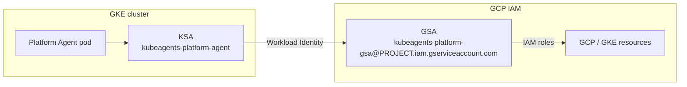

## What the agent can and cannot do

This is the canonical answer. Other pages summarize it and link here; if they appear to disagree, this page is correct.

"Is the agent read-only?" has **three different answers depending on which plane you mean.** Conflating them is the most common misreading of this project's security posture.

| Plane                         | What it governs                                                   | Can the agent write?                                                                                                                                                                                                                                                                                                             |
| ----------------------------- | ----------------------------------------------------------------- | -------------------------------------------------------------------------------------------------------------------------------------------------------------------------------------------------------------------------------------------------------------------------------------------------------------------------------- |
| **Kubernetes RBAC** (the KSA) | Everything the agent does against a cluster's Kubernetes API      | **No** for workloads and cluster state — read-only in every configuration apart from a leader-election housekeeping Role confined to its own namespace, and it cannot read Secret values. Enforced by RBAC and `<agent>-kube-proxy`.                                                                                             |
| **GCP IAM** (the GSA)         | GKE/Google Cloud control-plane calls, including via the `gke` MCP | **No write to infrastructure, with the default `read-only` permission set** — the one qualification is the Trace-console permissions the Trace role carries, under [Roles per set](#roles-per-set); the only other set the install offers is `custom`, whose roles you choose yourself. Enforced by IAM, chosen at install time. |
| **The GitOps path**           | Changes to your infrastructure-as-code repository                 | Yes — by opening a pull request a human must review and merge. Enforced by the credential proxy, which refuses the agent the GitHub write verbs (merge, approve, REST mutation, workflow and release triggers, repo administration).                                                                                             |

### What that means in practice

- **Workloads and cluster state cannot be mutated through the Kubernetes API by this agent.** The KSA's only write grant is the housekeeping Role `kubeagents:leader:<namespace>:<name>`: write on leader-election `leases`, confined to the agent's own namespace, plus `get`/`patch` on `pods` there **only when the deployment runs more than one replica** (`spec.deployment.availability.replicas`). That is when the leader-election wrapper that labels its own pod actually runs. The operator runs the gateway as a single replica whatever `spec.deployment.availability.replicas` asks for, so today the Role grants `leases` alone on every install. Beyond that it holds no write verb (see [Kubernetes RBAC](#kubernetes-rbac)). No other setting widens this.
  - A kubectl write the command policy refuses also ends the run's work on it. The runtime halts the turn at the first such refusal by default ([`permission_refusal_halt_after`](/kube-agents/reference/config/#tool_loop_guardrails)), and the worker is told to end its card (blocked, or completed when the card asked for a pull request) with the refusal quoted. The halt is enforced; the close is the worker's to follow.
- **GCP control-plane mutation is enforced off by default.** The default `read-only` permission set binds read roles, so a write to infrastructure fails at IAM. The one qualification is `roles/cloudtrace.user`, whose Trace-console permissions (analysis-report tasks and trace scopes) IAM does grant; [Roles per set](#roles-per-set) says which paths reach them and which cannot. The install no longer offers an admin bundle: `custom` is the only way to widen this, and it requires you to name every role.
  - If you do grant write roles that way, the `gke` MCP server's cluster-management tools are still refused: the agent's MCP client reaches that server only through the credential proxy, which relays its read-only tools and refuses the rest. Each profile's config also offers the model only that server's read tools, so `create_cluster`, `patch_k8s_resource` and the other write tools are not offered either.
- **Persona rules are guidance, not enforcement.** A prompt-injection or reasoning failure is bounded by IAM, not by `SOUL.md`. Keep the default `read-only` set if "read-only on the cloud plane" must be an enforced property of the deployment rather than an intended behaviour of the model (see [Configuring read-only mode](#configuring-read-only-auditing-mode)).
- **The intended write path is always GitOps** — the agent proposes, a human merges, your reconciler applies. The second half is enforced rather than intended: the credential proxy refuses `gh pr merge`, `gh pr review --approve`, mutating `gh api` calls, workflow and release triggers, and repository administration, so the actor that opens a pull request cannot also complete it. See [Secure write path](#secure-write-path-gitops) and [Credential isolation](/kube-agents/reference/credential-isolation/) for the rule ids.
- **The chat front door holds no infrastructure tools at all.** Chat ingress terminates at the Planning Agent (the pod's `default` Hermes profile), whose config pins every surface to routing, kanban-delegation, and per-user memory tools only: no GKE, file, or GitOps write tools. A prompt injected through chat must still be delegated to the Platform Agent, where the IAM and RBAC boundaries above apply. See [ChatOps](/kube-agents/concepts/chatops/).
  - The experimental [`platformFrontDoor`](https://github.com/gke-labs/kube-agents/blob/main/docs/designs/internals/platformagent-harness.md#platformfrontdoor) flag gives that up on purpose: it points chat ingress straight at the Platform Agent's toolset, so this row does not hold on an install that has turned it on. It also hands that profile's `config.yaml` to the agent, so the security and approval keys in it (`security.*`, `approvals.*`) stop being restored from the image on every restart. It is off by default and unsupported.
- **Cluster Agents are scoped-down, not scoped-up.** Each per-cluster [Cluster Agent](/kube-agents/concepts/cluster-agents/) profile shares the Platform Agent's identity path: the same gateway Pod and KSA, and the same credential broker for every proxied `kubectl` and `gcloud`, so the same RBAC and IAM ceilings apply. Its config template exposes only the read-only `gke` and `developer_knowledge` MCP servers, with no `platform_control` and no GitOps write path, and its `KUBECONFIG` is pinned to one cluster. It proposes fixes back over the kanban card; only the Platform Agent can turn them into PRs.
  - **The management cluster now has a Cluster Agent too,** so one of these profiles is scoped to the cluster kube-agents itself runs in and can read the harness's own namespace, including the namespace holding `platform-agent-secrets`. **How far that reach goes is set by the GSA's permission set, not by the Kubernetes RBAC row above.** A Cluster Agent does not reach its cluster as the KSA: `cluster_agent_profile.create_profile` runs `gcloud container clusters get-credentials` (through the credential broker, or answered by the shim after one relay read when the kube-api proxy is in use) and pins the resulting kubeconfig. Its Kubernetes API calls therefore authenticate as the broker's GSA (the kube-api proxy runs as the same identity), and the `kubeagents:minimal:*` ClusterRole does not bound them.
  - On an install that has armed the [scoped service account pool](#the-scoped-service-account-pool), `kubectl` under such a kubeconfig authenticates as its project's pool member instead. That is moot today, since the pool is suspended and off by default.
  - On the default `read-only` set, whose two `container.*` roles are `roles/container.clusterViewer` and `roles/container.viewer`, that means the harness's own workloads, their logs, ConfigMaps and events, and **not** its Secrets. On a `custom` set that names an admin role it means the full Kubernetes API on that cluster, **Secrets included**, so on such an install this profile can read the agent's own credentials. That reach is accepted on purpose on the default set: the management cluster's workloads fail like any other cluster's, and the agent that triages an event has to be the one scoped to the cluster that raised it.
  - If it is not acceptable on your install, most sharply if you have widened the GSA through `custom`, add the cluster's name to [`spec.scope.exclude.clusters`](/kube-agents/operator/platformagent-crd/#specscope) on the `PlatformAgent`; the next reconcile then prunes the profile. Name the cluster by project, location and name; the older `RECONCILE_EXCLUDE` bare-name variable still removes the profile for one release, but the broker doesn't enforce it. On an installer-managed install, put the triple in `SCOPE_EXCLUDE_CLUSTERS` in `install.env` and run `upgrade.sh --upgrade-mode=full`, which renders it onto the `PlatformAgent`; an edit made on the `PlatformAgent` itself is refused at the next full upgrade until it is recorded there.
  - The credential broker and `kube-proxy` then refuse every route to the cluster's Kubernetes API, for every caller. That bounds what the agents run, not the GSA: the management project always holds the agent's roles, so the identity itself still reaches the cluster.
  - Excluding it removes the Cluster Agent and, with it, `stall-watch`'s reads of that cluster, which follow the same profile roster. The per-cluster fleet audits and fleet answers leave it out too. The daily upgrade-readiness watch, the Saturday `upgrade-readiness-weekly-review` (whose findings on it reach the findings queue and the weekly brief), the networking audit's subnet usage and the GCE audit's instance listing still cover it, through control-plane reads only.

> The [end-state design](https://github.com/gke-labs/kube-agents/blob/main/docs/architecture/01-vision-scope.md) goes further: agents stay read-only on cloud APIs in every configuration, and the `create_cluster` tool is withdrawn. Removing the `gke-admin` bundle closed the one-word path to a writable GSA, and the tool list above keeps `create_cluster` out of the model's reach. Neither gets there on its own: `custom` can still be pointed at admin roles, and the credential behind the `gke` server can still call the tool. That part is a target, not current behaviour.

---

The rest of this page details the two enforced planes.

## Identity model

The agent uses [GKE Workload Identity](https://cloud.google.com/kubernetes-engine/docs/how-to/workload-identity) to bind its in-cluster KSA to a GSA, so no static GCP key lands in the cluster on a standard install. Clusters without Workload Identity can use the chart-only `litellm.vertex.credentialsSecretRef` escape hatch covered under [The Vertex AI gateway is a separate identity](https://github.com/gke-labs/kube-agents/blob/main/docs/designs/internals/../../../../../designs/internals/security-rbac.md#the-vertex-ai-gateway-is-a-separate-identity) below.



The IAM side of the binding is provisioned by the [`kube-agents-iam` Terraform module](https://github.com/gke-labs/kube-agents/tree/main/terraform/modules/kube-agents-iam), instantiated by the `terraform/examples/full-install` composition the installer drives. It grants `roles/iam.workloadIdentityUser` on the GSA to the KSA member `<project>.svc.id.goog[kubeagents-system/kubeagents-platform-agent]` (the KSA half is the composition's `agent_ksa_name`, `kubeagents-platform-agent` by default). The KSA-side annotation `iam.gke.io/gcp-service-account: kubeagents-platform-gsa@<project>.iam.gserviceaccount.com` is applied by the operator from `spec.security.serviceAccountAnnotations` on the [`PlatformAgent` CR](/kube-agents/operator/platformagent-crd/).

### The shell sandbox holds no cloud identity

GKE resolves Workload Identity by Pod IP, so every container in a Pod shares one cloud identity. The shell sandbox, where everything the model writes runs, is therefore a Pod of its own: the `<agent>-shell` StatefulSet runs under its own KSA, `<agent>-shell`, with **no** `iam.gke.io/gcp-service-account` annotation. The metadata server answers it with an unbound `<project>.svc.id.goog` principal that no IAM policy names. The credential broker runs in a separate Deployment, `<name>-credential-proxy`, under the annotated KSA above, and the sandbox reaches credentialed commands only through it ([Credential isolation](/kube-agents/reference/credential-isolation/) has the Pod anatomy). This layout cannot be turned off: `spec.harness.experimental.shellSandbox.enabled: false` parks the CR in `Degraded` with `ShellSandboxCannotBeDisabled` and changes nothing about the running workload.

`spec.security.workloadIdentityFederation` (`platformAgent.security.workloadIdentityFederation` in the chart) is the optional hardening on top. The broker then takes its cloud identity from an audience-scoped projected token mounted in its Pod alone, exchanged through [Workload Identity Federation](https://cloud.google.com/iam/docs/workload-identity-federation) for an impersonated `kubeagents-platform-gsa` token, rather than from the metadata server. Nothing creates the pool itself — not the chart, not the provisioning scripts, not the Terraform modules. The one-time `gcloud` commands are in [`designs/agent-shell-sandboxing.md`](https://github.com/gke-labs/kube-agents/blob/main/docs/designs/agent-shell-sandboxing.md#setting-up-the-pool).

## GCP IAM permission sets

The install grants the agent GSA one of two permission sets. Both entry points choose from the same vocabulary, and `read-only` is the default in each. The installer asks the question, or takes `--permission-set` / `--custom-roles`, and records the answer in `install.env` as `PLATFORM_AGENT_PERMISSION_SET` before generating `terraform.tfvars`. A hand-driven Terraform composition takes the same two values in its `permission_set` variable, with `custom` requiring a `project_roles` list; setting `project_roles` explicitly overrides `permission_set` either way.

| Permission set | `PLATFORM_AGENT_PERMISSION_SET` | Use it when                                                   |
| -------------- | ------------------------------- | ------------------------------------------------------------- |
| **read-only**  | `read-only` (default)           | Auditing / monitoring only — no write to infrastructure.      |
| **custom**     | `custom`                        | You supply the exact roles via `PLATFORM_AGENT_CUSTOM_ROLES`. |

### Roles per set

The default **read-only** set binds read roles, with one qualification under the Trace role:

- `roles/container.clusterViewer`, `roles/container.viewer` — read-only GKE.

  `roles/container.viewer` carries `container.thirdPartyObjects.list` and `.get`, which let the fleet-audit collectors list the Config Connector objects on a cluster. The collectors find the Config Connector kinds through the API server's discovery, which needs no grant. A `custom` set needs those two permissions or a Kubernetes RBAC grant of `list` on the Config Connector kinds. The collectors connect through `gcloud container clusters get-credentials`, so an RBAC grant names the agent's Google service account as a `User` subject (its email). Without that grant the read fails, no fix whose object is on that cluster gets the note about Config Connector, and the audit's log has a warning that names the clusters it could not read.

  A `custom` set also needs `container.namespaces.list` or a Kubernetes RBAC grant of `list` on namespaces. Without it, an object that takes its project from its namespace has no known project, so it matches a fix only when one cluster runs Config Connector, and no warning appears.

- `roles/compute.viewer` — read-only compute, reservations, machine types, and quota advice; the readiness report's `lb-connection-draining` and `orphan-node-objects` rules list a project's backend services and instances with it, and say `unknown` in a project that lacks it.
- `roles/monitoring.viewer`, `roles/logging.viewer` — read-only metrics and logs.
- `roles/gkehub.viewer` — read-only fleet membership and rollout sequencing (`gkehub.rolloutSequences.list`), for the readiness report's rollout-sequence precheck, which lists the fleet host project's RolloutSequences.
- `roles/cloudtrace.user` — trace reads (`cloudtrace.traces.get` and `.list`), for the observability skill's trace helpers through the credential broker's relay. Google's Trace User role also carries create, delete and update on Trace-console objects, analysis-report tasks and trace scopes, and no predefined Trace role grants the two reads without them, so a narrower grant is a custom role of your own.
  - The sandbox's route to Google is the broker. It forwards a relayed Trace read as a `GET` only, its one relayed `POST` is a Cloud Logging read, and its `gcloud` allowlist carries no `trace` command, so nothing the model's code sends through it uses those permissions.
  - A token minted on the annotated ServiceAccount itself carries every role bound to the identity, these permissions included. Only the credential broker Pod runs as it. The gateway Pod, and any `AgentPlugin` code it imports, reach the identity only through the broker's verbs and relay. The sandbox boundary and `AgentPlugin` notes below say what bounds those paths.
- `roles/iam.serviceAccountUser` — act as service accounts when running jobs.
- `roles/iam.securityReviewer` — read IAM policy for review.
- `roles/mcp.toolUser` — call the GKE MCP server.
- `roles/serviceusage.serviceUsageConsumer` — consume API quota for Developer Knowledge MCP queries.

`roles/container.viewer` is project-wide and unconditioned, so it reads Kubernetes objects in **every** cluster in the project. The grants of the scope's read roles, per project or inherited from a declared folder or organisation, extend that to every cluster in the scope. The [scoped service account pool](#the-scoped-service-account-pool) is where that narrowing is designed to land. It is suspended, so today nothing narrows it; the pool section says why. [`spec.scope.exclude.clusters`](/kube-agents/operator/platformagent-crd/#specscope) doesn't narrow the grant either. The credential broker and `kube-proxy` refuse an excluded cluster's Kubernetes API to every caller, but the identity's roles still reach it.

A binding on a folder or organisation named in [`spec.scope`](/kube-agents/operator/platformagent-crd/#specscope) is inherited by every project beneath it, which is what makes a container worth declaring and also what a grant there reaches.

A Shared VPC host or a Metrics Scope named there inherits nothing: each resolves to projects, and every one of them needs its own binding of the read roles. The Terraform composition makes those bindings after resolving the selector at plan time, so a project attached or linked after the last apply is unreadable until the next one. The lookups themselves need `compute.projects.get` in the host project, the two Resource Manager reads `roles/monitoring.metricsScopesViewer` carries in the scoping project, and `resourcemanager.projects.get` in each monitored project it names; the read roles carry all of them between them.

The **custom** set binds exactly the roles listed in `--custom-roles`, carried as the composition's `project_roles` list; none of the built-in role bundles are added. The list is space- or comma-separated, and the installer prompts for it and requires a non-empty value when this set is selected. A `custom` set that should keep the fleet audits' Config Connector note needs the grants named under [Roles per set](#roles-per-set) for `roles/container.viewer`. It also needs `container.clusters.get` (in `roles/container.clusterViewer`) for the credential fetch; without it, the audit cannot read the cluster's Config Connector objects, and the audit's log names the cluster.

If that list names a role like `roles/container.admin`, the installer says so at the point of choice — it is the authority the removed bundle granted, reached the long way round — and continues. It is your call to make, not the installer's.

### Projects, folders, organisations and selectors in scope

Every scope member gets less than the host project. The members are:

- a project named in `spec.scope.projects` (through `SCOPE_PROJECTS` in `install.env`, or the composition's `scope` variable);
- a folder or organisation named in `spec.scope.folders` or `spec.scope.organizations` (`SCOPE_FOLDERS`, `SCOPE_ORGANIZATIONS`);
- every project a Shared VPC host or Metrics Scope named in `spec.scope.sharedVpcHosts` or `spec.scope.metricsScopes` (`SCOPE_SHARED_VPC_HOSTS`, `SCOPE_METRICS_SCOPES`) resolves to at plan time, the scoping project included. A Shared VPC host not otherwise in scope gets `roles/compute.viewer` alone, for the lookup.

What a member gets is the read subset of the set above, intersected with whatever the host project was actually granted, and nothing else: `roles/container.clusterViewer`, `roles/container.viewer`, `roles/compute.viewer`, `roles/monitoring.viewer`, `roles/logging.viewer`, `roles/gkehub.viewer` and `roles/iam.securityReviewer`. The install is refused at plan time when the intersection carries neither `roles/container.clusterViewer` nor `roles/container.viewer`, the two roles that list and get clusters (`roles/iam.securityReviewer` lists but cannot get).

The roles that stay in the host project are `roles/iam.serviceAccountUser`, `roles/mcp.toolUser`, `roles/serviceusage.serviceUsageConsumer`, `roles/cloudtrace.user` and any role a `custom` set adds. The observability helpers read the install's own traces, and the Trace role's Trace-console permissions go nowhere else. So a `custom` list carrying `roles/container.admin` at home carries no `container.clusters.impersonate` anywhere else.

Beyond the agent's grants, the install creates one Log Router sink in each project named in `spec.scope.projects` or resolved from a Shared VPC host or Metrics Scope, while the drift detector is on. It exports the project's GKE admin-activity audit records into the management project's drift topic, where the subscription retains them for 31 days. A project a `SCOPE_EXCLUDE_PROJECTS` entry names or a glob there matches, or one `TF_VAR_drift_pubsub_source_exclude_projects` names, gets none, and a folder's or organisation's members get none.

Nothing here grants a write anywhere. What does widen is how much one credential can read. `roles/container.viewer` in each scoped project reads Kubernetes objects in every cluster there, the way it already does at home. A folder or organisation carries the same set plus `roles/cloudasset.viewer`, bound on the container itself and so inherited by every project beneath it. That is what lets a project created under a declared folder later be discovered and read with no change to the install, and is also why an organisation is wide.

`roles/cloudasset.viewer` is wider than cluster discovery: it lets the one credential search and export the asset inventory and the IAM policies of every resource under the container, not only its GKE clusters. So a container is declared only where reading all of that with one account is acceptable.

A Shared VPC host or a Metrics Scope inherits nothing: the read roles land in the projects it resolved to when Terraform last planned. So whoever can attach a service project to the host or link a project into the Metrics Scope chooses where the next full upgrade binds them. An `exclude.projects` entry that names a Shared VPC service project by ID, or a monitored project by its project number, withholds that grant.

Two projects keep theirs. A monitored project excluded by ID keeps it, because the reconcile has to name the project with the agent's own credentials before the exclusion can match. The scoping project keeps it however it is excluded, because the reconcile reads it to resolve the selector.

Removing a project, folder, organisation, Shared VPC host or Metrics Scope from the scope revokes its bindings on the next full upgrade, and uninstalling revokes them all, because Terraform owns them.

### Why there is no `gke-admin` set

There used to be a third set, `gke-admin`, which bound `roles/container.clusterAdmin` and `roles/container.admin`. It was removed rather than deprecated because it removed a ceiling rather than widening one:

- **GKE authorizes an action if _either_ IAM or Kubernetes RBAC allows it** ([Access control](https://docs.cloud.google.com/kubernetes-engine/docs/how-to/role-based-access-control)). A GSA holding `roles/container.admin` is authorized by IAM whatever the KSA's RBAC says, so the read-only Kubernetes footprint below stops constraining anything the agent reaches through that identity.
- **`roles/container.admin` is the one predefined GKE role that carries `container.clusters.impersonate`** — `roles/container.clusterAdmin` does not. GKE grants IAM roles at the project level; a cluster is not a resource an IAM policy attaches to, so "an IAM role grants privileges across all clusters in the project". The impersonation therefore cannot be narrowed to one cluster.

`custom` remains, so a deployment that genuinely needs broad roles still has a supported path — it just has to name each role, which makes the grant explicit and reviewable. Setting `PLATFORM_AGENT_PERMISSION_SET=gke-admin`, or `permission_set = "gke-admin"` in `terraform.tfvars`, now fails with an error rather than being silently downgraded. Re-running the install does not strip roles it no longer grants, so an existing GSA has to be brought back by hand — see below.

## The scoped service account pool

:::caution[Grants nothing today]
The pool provisions its service accounts, and those accounts hold no IAM grant. Each was scoped by an IAM Condition on the cluster's `resource.name`, and that grants nothing for Kubernetes object operations — measured across four condition spellings, one of which asserted only that the call was a GKE call. Deleting the condition is not the repair: un-conditioned, the same binding is project-wide `roles/container.viewer`, which is the ceiling the pool exists to remove. Both are gone.

So the pool is off by default and the broker runs on the agent's own identity, as it did before. Arming it is one explicit switch, and it should stay off: `scoped_pool_enabled` on the Terraform side (`SCOPED_SA_POOL_ENABLED` in `install.env`), or `platformAgent.security.scopedServiceAccountPool.enabled` in the chart for an install that writes the `PlatformAgent` CR by hand. Declaring a scope arms nothing. Authority arrives with per-cluster Kubernetes RBAC, which is a separate change.
:::

A Terraform install can provision one service account per GCP project in the agent's scope. The credential broker then mints a short-lived token for the account of the project a `kubectl` request's target cluster lives in, rather than running it on the agent's own identity. Two clusters in one project share an account: the project is the IAM unit the scope is declared in, and the unit an estate of one cluster per project is cut in.

The members are derived, not listed. With `scoped_pool_enabled` set on the [`kube-agents-iam`](https://github.com/gke-labs/kube-agents/blob/main/terraform/modules/kube-agents-iam) module, or on `terraform/examples/full-install`, which passes it through, the module creates one account per project. The projects are the host project, each project in `scope.projects`, and each project a Shared VPC host or Metrics Scope selector resolves to, less an exact `exclude.projects` entry. That is the resolved set the plan can list, which is not quite the set the scope's read roles are bound in:

- The host project gets an account and no scope binding, since it already carries the agent's own roles.
- A project named in `scope.projects` and in `exclude.projects` keeps its binding and gets no account.
- A monitored project excluded by its ID keeps its binding, because the reconcile has to name it before it can match the entry, and gets no account.
- A folder's or organisation's member projects are listed at plan time while the pool is armed, with the same Cloud Asset Inventory search the reconcile runs. They get their accounts on that apply and no drift audit-log sink (which projects get one is said above), and nothing else: the container's grant and discovery stay zero-touch.
- A project created under the folder between applies is discovered and gets its profile at the next reconcile, and every `kubectl` for it is refused until the next apply adds its account.
- A project added to `scope.projects` gets its account on the apply that grants its roles.

The listing is one answer from an eventually consistent index with no grace at plan time. A project the index leaves out on one plan loses its account on that apply and gets a new one, under a new unique ID, on the next. So a project whose account must not move is pinned in `scope.projects`, and the plan warns when a container answers no member at all.

The identity that applies needs `roles/cloudasset.viewer` on the container for the listing, which the installer's container preflight probes while the pool is armed. `install.sh` enables the Asset API in the host project before such a plan; an upgrade that adds the first container and arms the pool in one pass is refused at the plan with the enable command named. A cluster in a project with no account is refused rather than served by a wider credential, with a refusal naming the project and the cluster.

**Upgrading an install that armed the pool under the per-cluster field.** The CRD update prunes `spec.security.scopedServiceAccounts` from the stored `PlatformAgent`, `scopedServiceAccountPool.enabled` defaults to false, and the operator renders `CREDENTIAL_PROXY_SCOPED_SA_POOL=0`: every cluster read goes back to the agent's own identity, which still carries `roles/container.viewer`, with no Event or condition saying so. An install that drives the `kube-agents-iam` module directly with `scoped_clusters` loses that variable, and its next apply destroys the per-cluster accounts. To stay armed across the upgrade, set `scoped_pool_enabled` (or `SCOPED_SA_POOL_ENABLED=true`) in the same apply, and expect new per-project accounts in place of the per-cluster ones. No known install had armed the pool.

The accounts are created in the host project, whose service-account quota is 100 by default and is shared with the agent's own accounts and everything else there. `scoped_pool_max_accounts` is the bound you declare from the headroom that quota has free; its default is the quota itself, so a large pool at the default can still meet the quota mid-apply. The module refuses a plan whose derived set exceeds the declared bound, and an estate above the quota raises it first and the bound with it.

The narrowing that was to go with it is suspended. The agent's own GSA was to drop `roles/container.viewer` whenever the pool was populated, keeping `roles/container.clusterViewer` — able to enumerate clusters and run `get-credentials`, unable to read anything inside one. The two changes are coupled because neither is safe alone: narrowing the agent while the pool grants nothing breaks every read, and arming the pool while the agent stays wide leaves the ceiling the pool exists to remove. Both are off, and a test holds the two halves together.

The module grants the agent `roles/iam.serviceAccountTokenCreator` **on each pool member as a resource**, never at project level. At project level that role would let the agent mint a token for any service account in the project, which would make the pool decorative.

The mapping reaches the broker through `spec.security.scopedServiceAccountPool` on the [`PlatformAgent` CR](/kube-agents/operator/platformagent-crd/): `enabled`, and one `serviceAccounts` row per project with its `projectId` and `serviceAccountEmail`. The operator renders the rows into the credential-proxy ConfigMap and sets `CREDENTIAL_PROXY_SCOPED_SA_POOL` on the broker container from `enabled` alone. That variable is written in both directions, so which credential mode an install is in is readable from the Deployment rather than inferred from what is absent.

**What the pool does not cover.** It scopes `kubectl`, and only `kubectl`, through the credential broker. `gcloud` also goes through the broker but stays on the agent's own identity: it names its target in argv, and deciding scope from argv would put a parser where the boundary belongs. So does the forge work the version-control verbs ask the broker to do. The sandbox's own `git` is local and holds no credential, and there is no `gh` in it.

The `gke` MCP server goes through the broker too, on the broker's own credential rather than a pool member. What bounds it is the broker's per-tool allowlist, which relays the server's read-only tools only, and then the size of that grant. What bounds `gcloud` and the forge work is the size of the agent's own grant, which is the other half of why `roles/container.viewer` was to come off it.

## Kubernetes RBAC

This section has its own dedicated reference page: [Security: Kubernetes RBAC](https://github.com/gke-labs/kube-agents/blob/main/docs/designs/internals/../../../../../designs/internals/security-rbac.md).

## Configuring read-only (auditing) mode

`read-only` is the install default, so a fresh install already runs in this posture. To pin it explicitly, or to bring a deployment provisioned with the removed `gke-admin` set back to it:

- **With the installer (recommended)** — accept the default option in its permission-set menu, or pass it explicitly (a re-run reconciles the change through one `terraform apply`):

  ```bash
  curl -fsSL https://raw.githubusercontent.com/gke-labs/kube-agents/<RELEASE_VERSION>/install.sh | bash -s -- \
    --permission-set=read-only
  ```

- **With a hand-driven Terraform composition** — set `permission_set = "read-only"` in `terraform.tfvars` and apply.

- **On an existing GSA provisioned with the old `gke-admin` set** — re-running the install will not strip roles it no longer grants, so swap the admin roles for viewers by hand:

  ```bash
  PROJECT_ID="your-gcp-project-id"
  GSA_EMAIL="kubeagents-platform-gsa@${PROJECT_ID}.iam.gserviceaccount.com"

  # Remove the admin roles
  for role in roles/container.clusterAdmin roles/container.admin roles/monitoring.admin; do
    gcloud projects remove-iam-policy-binding "${PROJECT_ID}" \
      --member="serviceAccount:${GSA_EMAIL}" --role="${role}"
  done

  # Add the read-only roles -- all eleven, not just the three removed above.
  # add-iam-policy-binding is idempotent, so naming one the GSA already holds
  # costs nothing.
  for role in roles/container.clusterViewer roles/container.viewer roles/compute.viewer \
    roles/monitoring.viewer roles/logging.viewer roles/gkehub.viewer roles/cloudtrace.user \
    roles/iam.serviceAccountUser roles/iam.securityReviewer roles/mcp.toolUser \
    roles/serviceusage.serviceUsageConsumer; do
    gcloud projects add-iam-policy-binding "${PROJECT_ID}" \
      --member="serviceAccount:${GSA_EMAIL}" --role="${role}"
  done
  ```

  The eleven are `local.read_only_roles` in `terraform/examples/full-install/main.tf`.

The Kubernetes RBAC above is already read-only in every mode, so no cluster-side change is needed. Neither is the GitOps path affected: the agent proposes pull requests under every permission set, because what makes it propose rather than apply is Kubernetes RBAC, not the IAM set.

## Secure write path: GitOps

Because the agent's Kubernetes RBAC is read-only, remediations are proposed rather than applied:

1. The agent invokes the [`submit-suggestion`](/kube-agents/concepts/declarative-workflow/) skill with a proposed diff — or, for a scheduled fleet audit, the `fleet-audit` skill with a validated findings file.
2. The skill's helper commits to a topic branch and asks the credential broker to publish it; the broker — not the helper — calls [Minty](/kube-agents/deploy/token-minter/) for a short-lived GitHub App token.
3. A Pull Request is opened against your GitOps repository. `fleet-audit` publishes its report as one GitHub issue per audit stream — the ledger, rewritten in place each run — and opens a narrow Pull Request only for a finding whose fix is a manifest, linked back to that ledger. One more machine-owned issue exists. `chat-delivery-watch`, a scheduled script with no model in the loop, opens, edits and closes a single issue labelled `agent:delivery-watch` in that repository (or the one `CHAT_DELIVERY_LEDGER_REPO` names) when scheduled reports stop reaching chat. It creates that label if it is missing; [the relay design](https://github.com/gke-labs/kube-agents/blob/main/docs/designs/cron-report-relay.md) has the reasoning.
4. A human reviews and merges; a GitOps controller (Argo CD, Flux) reconciles the change into the cluster.

Onboarding opens one more machine-owned issue. When nobody has written to the agent in chat a day after its first inventory sweep, the delivery stage files the first-run report once, as an issue labelled `agent:onboarding`. It goes to that repository when it is on GitHub, or else to the install's one managed GitHub repository (or the one `ONBOARDING_LEDGER_REPO` names). That stage is a script with no model in the loop. It creates the label if needed and never rewrites the issue; [the onboarding design](https://github.com/gke-labs/kube-agents/blob/main/docs/designs/oobe.md) §3 has the timing.

Both paths share the same guardrails. The helper stages the paths it is named, or, named none, only files the working copy already tracks, never `git add .` or `git add -A`, and pushes to `main`, `master`, and `production` are hard-blocked. The `submit-suggestion` path carries one the audit path does not: a file the agent never staged itself is refused by name rather than swept into the change.

A `gitops` or `managed` repository that sets [`baseBranch`](/kube-agents/operator/platformagent-crd/#specintegration) adds that branch to the blocked pushes and pins that repository's pull requests to it. The credential broker refuses one opened onto any other branch, and pull requests opened before the field was set keep their base. The only branch the version-control verbs will delete is a spent one of the agent's own: under `platform-agent/`, with no open pull request, and still at the revision a closed or merged pull request from the same repository carried. That means one this install opened, whenever its credential can name its own login.

The agent never has direct write access to running infrastructure — see [Declarative workflow](/kube-agents/concepts/declarative-workflow/).

### Explain-only mode

Set `KUBEAGENTS_WRITE_MODE` to `none` to stop the agent proposing changes. Set it in the chart value
`platformAgent.deployment.env` (on the Terraform install, through `extra_helm_values`); edit the
PlatformAgent's `spec.deployment.env` directly only on an install without the chart, because a chart
apply can replace that list. A change applies once the operator has rolled the broker, the one
component that reads it; the gateway Pod rolls with it.

At `none` the credential broker refuses every branch push and branch delete and every pull request
write, including comments and reactions, with the code `WRITE_MODE_NONE`, and the refusal tells the
agent the install is explain-only. Issues and reads are unaffected, so an audit still publishes its
report issue. Unset or `propose` is the default: the agent pushes branches and opens pull requests.
Any other value is treated as `none`.

With `KUBEAGENTS_DIAL` set to `on`, the broker also reads the autonomy dial's level, and the stricter
of the two applies: at Explain the broker refuses what `none` refuses, and the refusal's detail names
the dial. The broker keeps the last level it was given for as long as its Pod lives; a new broker Pod,
which every operator roll makes, reads Explain until it is given one.

The level is set through the broker's `POST /v1/dial` route, which only the agent Pod's chat role may call, so no command the agent
runs in the sandbox can move it. Below Auto-merge proven fixes the broker also refuses any write that
adds the `kube-agents:auto-merge` label, with the code `DIAL_AUTOMERGE_OFF`. Nothing calls the route
yet, so turning `KUBEAGENTS_DIAL` on today makes the install explain-only.

## Change control & safety

This section has its own dedicated reference page: [Security: Change control & safety](https://github.com/gke-labs/kube-agents/blob/main/docs/designs/internals/../../../../../designs/internals/security-change-control.md).

## Secrets Encryption & Local State Security

### GKE etcd Database Encryption (CMEK)

The install enforces Customer-Managed Encryption Keys (CMEK) for GKE database encryption:

- **Automated Cloud KMS Setup**: On a cluster the install creates, the [`gke-cluster` module](https://github.com/gke-labs/kube-agents/tree/main/terraform/modules/gke-cluster)'s `enable_database_encryption` (default `true`) creates a dedicated Cloud KMS keyring and crypto key, grants the GKE service agent `roles/cloudkms.cryptoKeyEncrypterDecrypter`, and creates the cluster encrypted.
- **Existing clusters**: Terraform cannot mutate a cluster it did not create, so the installer (`install.sh`) runs a `gcloud` pre-step before the apply: it ensures the keyring, key, and service-agent binding exist and updates the live cluster's database encryption. Clusters that are already encrypted are left alone.
- **`ALLOW_UNENCRYPTED_SECRETS` Override**: When installing onto an existing cluster or local test environment where CMEK must stay off, export `ALLOW_UNENCRYPTED_SECRETS=true` to skip that pre-step.

### Local State Security (`install.env`)

The install configuration written during installer execution (`install.env`) is hardened as follows:

- **File Permissions**: State files are created with strict POSIX permissions (`umask 077` and `chmod 600`), preventing non-owner access. The `terraform.tfvars` the installer generates from it gets the same `0600` treatment, and is regenerated on every run so the two cannot disagree.
- **`PERSIST_SECRETS_ON_DISK`**: By default (`PERSIST_SECRETS_ON_DISK=true`), credentials entered during installation are stored in `install.env` for non-interactive re-runs. Set `PERSIST_SECRETS_ON_DISK=false` to prevent writing sensitive credentials to disk.
- **Secrets also live in Terraform state.** Every credential passed through the composition is stored in plaintext in the Terraform state, which the installer keeps in a GCS bucket (`<project>-kube-agents-tfstate`, versioned). Restrict that bucket's IAM to the administrators who may read the credentials; see the [composition README](https://github.com/gke-labs/kube-agents/tree/main/terraform/examples/full-install)'s warning.

## Where to go next

- [Credential isolation](/kube-agents/reference/credential-isolation/) — how credentials are kept out of the agent sandbox container.
- [Platform Agent](/kube-agents/concepts/platform-agent/) — the persona and least-privilege stance.
- [PlatformAgent CRD](/kube-agents/operator/platformagent-crd/) — `spec.security` and the permission set field.
- [User attribution](/kube-agents/reference/attribution/) — tracing an action back to the human who requested it.
- [`terraform/modules/kube-agents-iam`](https://github.com/gke-labs/kube-agents/tree/main/terraform/modules/kube-agents-iam) — where the IAM is laid down.
- [`docs/security-requirements.md`](https://github.com/gke-labs/kube-agents/blob/main/docs/security-requirements.md) — the provider-neutral security configuration model: the permission / interaction / authorization dimensions, what is current behaviour versus planned capability, and the acceptance criteria.
